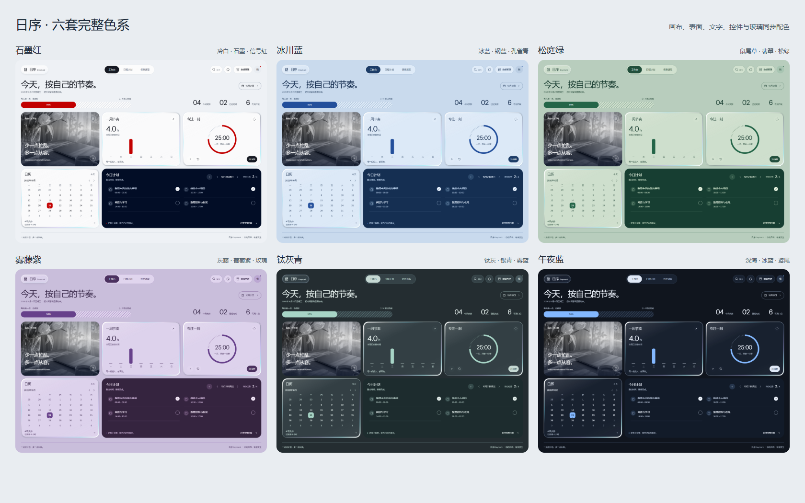
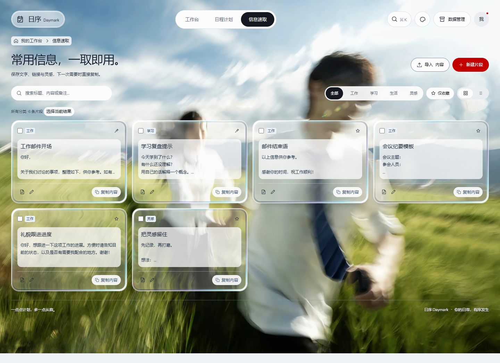

# 日序 Daymark

一个将日程安排、常用信息和专注计时放在一起的个人效率工作台。

## 工作台与壁纸玻璃

开启壁纸后，背景保留原图色彩，玻璃卡片会折射壁纸；首页同时展示专注计时、每周节奏、日历和当天计划。


## 六套完整主题

主题会同步调整画布、卡片、文字、控件和玻璃配色，可随时切换浅色与深色风格。



## 信息速取

保存并分类常用片段，通过搜索、收藏筛选快速找到并复制需要的内容；壁纸和玻璃材质可与所选主题搭配。



## 功能

- 按日期和时间管理任务，支持日历、日视图、周视图和任务清单。
- 保存、搜索、分类、收藏和复制常用文字片段。
- 使用 15、25 或 50 分钟专注计时。
- 导入、导出 JSON 数据，导入 Markdown，导出 iCalendar（`.ics`）。
- 切换主题、材质和自定义封面或壁纸，裁剪时可缩放、移动并水平或上下翻转图片。

## 运行

需要 Node.js 22 或更新版本，无需安装任何第三方依赖。

打开终端进入本项目文件夹，执行：

```powershell
npm start
```

终端会显示本机访问地址，在浏览器中打开该地址即可使用。服务只监听本机，同一网络的其他设备无法访问；使用期间保持终端窗口开启，按 `Ctrl+C` 可停止服务。

运行测试：

```powershell
npm test
```

## 数据与隐私

任务和信息片段保存在当前浏览器的本地存储中，不会自动上传或跨设备同步。请使用工作台内的数据管理功能备份或迁移数据。自定义图片保存在 `data/media/`，该目录不会纳入版本控制。

首次打开会显示可编辑的通用示例。应用不需要账户或远程服务。

## 许可

本项目采用自定义的**个人非商业使用许可**：个人可以在本地运行和修改自己的副本，但不得商用、出售、转发或再发布项目副本及修改版。可以分享原始 GitHub 仓库链接。该许可不是开源许可证；第三方材料仍遵循各自的许可。详情见 [LICENSE](LICENSE)。

## 项目结构

- `server.mjs`：本地 HTTP 服务。
- `dist/`：工作台界面及静态资源。
- `lib/`：图片存储逻辑。
- `tests/`：逻辑和服务测试。
- `screenshots/`：工作台和功能展示图。

第三方许可信息见 [THIRD_PARTY_NOTICES.md](THIRD_PARTY_NOTICES.md)。
